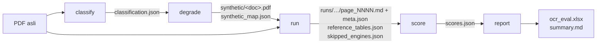

# Arsitektur alat evaluasi OCR

Cara setup dan menjalankan ada di [eval/README.md](../../eval/README.md). Dokumen ini menjelaskan bagaimana alat itu
tersusun. Definisi metrik ada di [metodologi.md](metodologi.md).

## Pipeline

Lima tahap, masing-masing satu subperintah `python -m ocr_eval <tahap>`; `all` menjalankan kelimanya berurutan dan
berhenti setelah `run` bila gerbang biaya menolak (kode keluar 2). Setiap tahap membaca file tahap sebelumnya dari
folder `--out`, jadi tahap bisa dijalankan ulang sendiri-sendiri.



| Tahap | Fungsi (`cli.py`) | Membaca | Menulis di `--out` |
|---|---|---|---|
| `classify` | `cmd_classify` | PDF | `classification.json`: `{doc: {page: "digital" \| "scan" \| "scan_with_hidden_text"}}` |
| `degrade` | `cmd_degrade` | `classification.json` | `synthetic/<doc>.pdf` (hanya halaman digital, sebagai gambar terdegradasi) dan `synthetic_map.json`: `{doc: {halaman sintetis: halaman asal}}` |
| `run` | `cmd_run` | `classification.json`, `synthetic_map.json` | `runs/<variant>/<doc>/<engine>/page_NNNN.md` + `meta.json`, `reference_tables.json`, `skipped_engines.json` |
| `score` | `cmd_score` | semua di atas + PDF | `scores.json`: `{"rows": [PageRow…], "balance": {doc: {engine: true/false/null}}}` |
| `report` | `cmd_report` | `scores.json`, `runs/*/*/*/meta.json`, `classification.json`, `synthetic_map.json`, `reference_tables.json`, `skipped_engines.json` | `ocr_eval.xlsx` (sheet Summary, Pages, Worst pages, Classification, Notes) dan `summary.md` |

`<doc>` adalah nama file PDF tanpa ekstensi (`Path.stem`). `<variant>` adalah `original` (PDF asli, semua halaman)
atau `synthetic` (PDF scan sintetis). Nomor halaman di `runs/synthetic/` adalah nomor di PDF sintetis;
`synthetic_map.json` memetakannya kembali ke halaman asal saat scoring. `degrade` melewati dokumen yang PDF
sintetisnya sudah ada dan tercatat di `synthetic_map.json`; `classify` menimpa entri dokumen yang diberikan.

`reference_tables.json` berisi `{doc: [{"page": n, "grid": [[sel…]…]}…]}`: tabel acuan dari Docling untuk setiap
dokumen yang punya halaman digital (lihat [Docling](#docling-dan-mineru-subprocess)).

## Peta modul

`eval/ocr_eval/`:

| Modul | Isi |
|---|---|
| `__main__.py` | Entry point `python -m ocr_eval` → `cli.main` |
| `cli.py` | Parsing argumen, lima tahap, `build_engines`, lane paralel, gerbang biaya, catatan tambahan laporan |
| `store.py` | `PageOutput`, protokol `Engine`, `RunStore` (cache per halaman), `run_engine` (menjalankan halaman yang belum di-cache dan mencatat waktu) |
| `classify.py` | `PageKind` dan `classify_pdf`: klasifikasi halaman dari text layer dan gambar |
| `degrade.py` | `degrade_pdf`: render halaman digital ke gambar terdegradasi (scan sintetis) |
| `numbers.py` | Ekstraksi dan normalisasi angka, `score_numbers` (cocok / salah baca / hilang / tambahan / negatif) |
| `text_metrics.py` | `word_dice` dan `english_coverage` |
| `tables.py` | `parse_tables` (tabel HTML dan pipe), `amount_columns`, `score_columns` |
| `accounting.py` | `check_totals` (baris Jumlah/Total) dan `check_balance` (aset = liabilitas + ekuitas) |
| `agreement.py` | `consensus` dan `score_against_consensus` untuk scan asli |
| `score.py` | `score_run` (satu `PageRow` per halaman × engine × kolom), `balance_checks`, `coverage_gaps`, `summarize` (satu `Summary` per kolom × engine) |
| `report.py` | `standard_notes` dan `write_report` (Excel dan markdown) |

`eval/ocr_eval/engines/`:

| Modul | Isi |
|---|---|
| `unlimited.py` | `UnlimitedEngine`: render halaman ke PNG dan panggil vLLM lewat `VllmOcrEngine` dari `api/` |
| `cloud.py` | `AzureEngine`, `MistralEngine` (turunan `_ChunkedEngine`) dan `split_pdf` |
| `subprocess_engine.py` | `SubprocessEngine`: menjalankan worker Docling/MinerU di venv-nya sendiri, `worker_env`, `reference_tables` |

`eval/ocr_eval/workers/` (dijalankan oleh interpreter `eval/.venv-docling` atau `eval/.venv-mineru`, bukan diimpor
oleh `ocr_eval`):

| Modul | Isi |
|---|---|
| `_common.py` | Argumen CLI worker (`--pdf --pages --out --mode`), `subset_pdf` (pypdfium2), `write_page`, `write_meta`, `anchor_grid` |
| `docling_worker.py` | Mode `auto`, `ocr`, `reference-tables` |
| `mineru_worker.py` | Mode `auto`, `ocr`; mengubah `*_content_list.json` MinerU menjadi markdown |

## Protokol `Engine`

Didefinisikan di `store.py` sebagai `typing.Protocol`; engine tidak perlu mewarisi kelas apa pun.

```python
class Engine(Protocol):
    name: str                          # nama folder di runs/ dan baris di laporan
    paid_price_per_page: float | None  # US$/halaman; None untuk self-hosted
    def available(self) -> str | None: ...   # alasan tidak bisa dipakai, atau None
    def meta_info(self) -> dict: ...         # field (model, versi, …) yang dicatat di meta.json
    def run(self, pdf: Path, pages: list[int], *, is_scan_variant: bool) -> AsyncIterator[PageOutput]: ...
```

`run` adalah async generator yang menghasilkan satu `PageOutput(page, markdown, seconds, error=None,
truncated=False)` per halaman yang diminta, dalam urutan apa pun. Kegagalan dilaporkan sebagai `PageOutput` dengan
`markdown=""` dan `error` terisi, bukan sebagai exception, supaya halaman lain tetap tersimpan. `is_scan_variant`
bernilai `True` untuk PDF scan sintetis.

## Cara tiap engine dipanggil

### Unlimited-OCR (`engines/unlimited.py`)

- Memanggil vLLM langsung (bukan lewat REST API di `api/`) dengan `VllmOcrEngine`, `parse_blocks`, dan
  `to_markdown` dari `api/`, sehingga parsing output sama dengan produksi.
- Model dan parameter generasi (`model_name`, `max_tokens`, `ngram_size`, `single_image_window`,
  `multi_image_window`) serta `vllm_base_url` diambil dari `Settings` API (variabel `OCR_*` di `.env`).
- Setiap halaman dirender ke PNG pada 200 DPI, juga untuk PDF asli: Unlimited-OCR selalu membaca gambar, tidak pernah
  text layer. Satu request per halaman, maksimal 32 bersamaan (`concurrency`).
- `truncated` diambil dari output vLLM (finish_reason=length). `available()` mengecek `GET /models`.

### Azure Document Intelligence dan Mistral OCR (`engines/cloud.py`)

- Memakai adapter dari `api/` (`AzureDocumentIntelligence`; untuk Mistral `_document` dan `to_results`, dengan POST
  `/ocr` diulang di sini supaya nama model dari respons tercatat).
- Halaman yang diminta dipotong menjadi PDF berisi maksimal 25 halaman (`split_pdf`), dikirim **berurutan** (bukan
  paralel) untuk menghindari rate limit. Nomor halaman hasil dipetakan kembali ke nomor asli.
- Bila satu chunk gagal, semua halamannya mendapat `error` dan chunk berikutnya tetap dicoba. Halaman yang tidak
  dikembalikan engine mendapat error `engine returned no result for this page`.
- `seconds` per halaman = waktu chunk / jumlah halaman chunk.
- Harga: Azure `paid_price_per_page = 0.010`, Mistral `0.004` (US$). `available()` mengecek key dan endpoint di
  `Settings`.
- PDF asli dikirim apa adanya, jadi Azure mungkin memakai text layer pada halaman digital.

### Docling dan MinerU (subprocess)

- `SubprocessEngine` menjalankan `eval/.venv-<name>/bin/python eval/ocr_eval/workers/<name>_worker.py --pdf …
  --pages 1,2,… --out <tmp> --mode <mode>`. Dependensinya tidak pernah bercampur dengan `api/` atau `eval/.venv`.
- Halaman diproses per 25 (`CHUNK_PAGES`), satu proses worker per chunk, dengan batas waktu 1800 detik per chunk
  (`CHUNK_TIMEOUT_SECONDS`). Saat timeout atau pembatalan, seluruh process group worker di-kill sehingga GPU tidak
  tertahan. Crash atau timeout hanya menggagalkan halaman chunk itu.
- Worker berjalan di GPU 1 (`CUDA_VISIBLE_DEVICES=1`). `worker_env` mengarahkan semua cache (pip, HF, ModelScope,
  XDG, torch, EasyOCR, serta `MINERU_TOOLS_CONFIG_JSON`) ke `eval/.cache`, karena disk root kecil.
- Worker memotong PDF ke halaman yang diminta (`subset_pdf`), menulis `page_NNNN.md` per halaman dan
  `worker_meta.json` (`model`, `version`, `seconds_total`, …). `seconds` per halaman = `seconds_total` / jumlah
  halaman chunk.
- Mode: `auto` untuk PDF asli, `ocr` untuk scan sintetis.
  - Docling `auto`: EasyOCR (`id`, `en`) untuk bitmap, text layer dipakai bila ada. `ocr`: OCR penuh setiap halaman
    (`force_full_page_ocr`). Keduanya memakai backend pypdfium2 (`PyPdfiumDocumentBackend`), karena backend default
    docling-parse merender halaman gambar terlalu buruk untuk EasyOCR.
  - Docling `reference-tables`: tanpa OCR, backend default docling-parse, struktur tabel TableFormer dengan isi sel
    dari text layer. Menghasilkan `tables.json` untuk `reference_tables.json`.
  - MinerU: `mineru -b pipeline -m <auto|ocr> -l latin` (alias untuk model PP-OCRv5 `ch`).
- Tabel acuan (`SubprocessEngine.reference_tables`) dijalankan sekali per dokumen yang punya halaman digital dan
  belum ada di `reference_tables.json`, pada semua halaman dokumen, tanpa chunk dan tanpa timeout.

## Cache dan resume (`store.py`)

- `RunStore` menyimpan `runs/<variant>/<doc>/<engine>/page_NNNN.md` (nomor 4 digit) dan satu `meta.json` per
  folder. `meta.json` berisi `pages: {"<n>": {"seconds", "error", "truncated"}}` plus field run.
- `missing_pages` = halaman yang file `.md`-nya belum ada **atau** yang tercatat dengan `error`. Jadi halaman gagal
  selalu dicoba lagi pada run berikutnya; halaman yang berhasil tidak pernah diproses (atau ditagih) ulang.
- `meta.json` ditulis atomik: ke `meta.json.tmp` lalu `os.replace`.
- `run_engine` hanya menjalankan halaman yang hilang. Ia mencatat `started` di awal, lalu di blok `finally` (juga
  saat run terputus atau engine melempar exception) menambahkan `meta_info()` engine, `wall_seconds` (akumulasi
  waktu wall-clock semua run) dan `timed_pages` (akumulasi halaman yang dihasilkan selama diukur). Waktu per halaman
  di laporan = `wall_seconds / timed_pages`.
- Sebelum engine dijalankan, `cmd_run` mencatat `price_per_page` (None untuk self-hosted) di `meta.json`, supaya
  biaya diketahui walaupun run terputus.
- Konsekuensinya: folder `--out` harus tetap antar run. Folder baru berarti semua halaman diproses dan ditagih ulang.

## Concurrency: lane

`cmd_run` menyusun langkah ke dalam *lane*. Langkah di satu lane berjalan berurutan; semua lane berjalan bersamaan
(`asyncio.gather`). Langkah yang gagal dicatat (`[gagal] …`) tanpa menghentikan lane lain; `run` lalu keluar
dengan kode 1.

```
lane gpu1      : tabel acuan doc A → tabel acuan doc B → docling original/A → docling original/B
                 → docling synthetic/A → … → mineru original/A → … → mineru synthetic/B
lane unlimited : unlimited original/A → … → unlimited synthetic/B      (GPU 0, lewat vLLM)
lane azure     : azure original/A → … → azure synthetic/B
lane mistral   : mistral original/A → … → mistral synthetic/B
```

Docling dan MinerU berbagi lane `gpu1` (`_SHARED_GPU`), jadi keduanya bergantian di GPU 1 dan tidak pernah
bersamaan; tabel acuan masuk lane yang sama (`_REFERENCE_LANE`) dan diantrikan lebih dulu. Engine lain mendapat
lane sendiri dengan nama engine. Urutan job per engine: semua PDF asli, lalu semua PDF sintetis. Urutan Docling vs
MinerU mengikuti urutan `--engines` (default: Docling dulu).

## Gerbang biaya

1. Engine yang `available()`-nya mengembalikan alasan dilewati; alasannya ditulis ke `skipped_engines.json` dan
   muncul di Notes laporan.
2. Untuk engine yang siap dan berbayar (`paid_price_per_page` bukan `None`), `_estimate` menghitung halaman yang
   belum di-cache (termasuk yang gagal) × harga per halaman, per engine dan total, lalu mencetaknya.
3. Tanpa `--yes`, bila ada engine berbayar dengan halaman belum di-cache, `run` keluar dengan kode 2 **sebelum
   menjalankan apa pun**, termasuk engine self-hosted dan tabel acuan. Keputusan biaya diambil sebelum berjam-jam
   kerja GPU, bukan di tengahnya.
4. Bila semua halaman berbayar sudah di-cache, atau tidak ada engine berbayar yang siap, `run` berjalan tanpa
   `--yes`.
